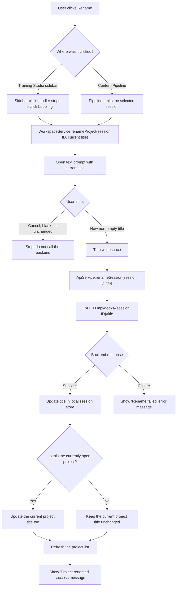

# Project Rename Functionality

This guide explains how a user renames a project in the SE Agent web app. In this app,
a project is represented by a session, so the project title is the session title.

## In simple terms

The rename feature is available in two places:

- In the project list in the Training Studio sidebar, using the pencil icon.
- In the Content Pipeline, using the **Rename** button on a project row.

Both controls use the same shared workflow. The app asks for a new title, sends it to the
backend, and updates the title shown in the app when the backend confirms the change.

## Complete flow

### What happens at each step

1. **The user starts from either UI location.** The sidebar invokes the workspace workflow
   directly. The Pipeline emits the chosen session, and the parent component forwards its
   ID and title to the same workflow.
2. **The app asks for the new title.** The prompt is pre-filled with the current title.
3. **The app checks the input.** It trims surrounding whitespace. If the user cancels,
   enters only whitespace, or leaves the title unchanged, the workflow ends without making
   a request.
4. **The API client sends the change.** It sends a `PATCH` request with a JSON body such as
   `{"title":"New project name"}` to `/api/decks/{session ID}/title`. The `/api` prefix is
   supplied by the app's shared API configuration.
5. **The app handles the response.** On success, it uses the title returned by the backend
   when available (otherwise the submitted title), updates the local project data, and also
   updates the current-project title if that project is open.
6. **The app gives feedback.** The project list is refreshed and a success toast is shown.
   If the request fails, an error toast is shown instead.

## Changed files

The following files contain the rename implementation:

| File | What changed | Why |
|---|---|---|
| [`src/app/training-studio/training-studio.component.html`](src/app/training-studio/training-studio.component.html) | Adds a pencil-icon **Rename project** button beside each project in the sidebar. The button is disabled while that project is being deleted. | Gives users a quick way to rename a project where they browse and select projects. |
| [`src/app/training-studio/training-studio.component.ts`](src/app/training-studio/training-studio.component.ts) | Adds `onRenameSessionClick`, which stops the click from also selecting the project and calls `vm.renameProject` with the session ID and current title. | Keeps the rename click from triggering the row's project-selection behavior and passes the right data to the shared workflow. |
| [`src/app/pipeline/pipeline.component.html`](src/app/pipeline/pipeline.component.html) | Adds a **Rename** button to each project row. It is disabled while that project is being deleted. | Makes the same action available from the Content Pipeline. |
| [`src/app/pipeline/pipeline.component.ts`](src/app/pipeline/pipeline.component.ts) | Adds the `renameSession` output event, which emits the selected session. | Lets the Pipeline report the user's choice without duplicating the rename logic inside the component. |
| [`src/app/main/main.component.html`](src/app/main/main.component.html) | Connects the Pipeline's `renameSession` event to `vm.renameProject(...)`, passing the selected session's ID and title. | Routes the Pipeline action to the same workflow used by the sidebar. |
| [`src/app/shared/services/workspace.service.ts`](src/app/shared/services/workspace.service.ts) | Adds `renameProject`, which prompts for a title, skips cancelled/blank/unchanged values, calls the API service, updates local titles, refreshes the list, and displays success or failure feedback. | Centralizes the workflow so both entry points behave consistently and the UI state stays up to date. |
| [`src/app/shared/services/api.service.ts`](src/app/shared/services/api.service.ts) | Adds `renameSession`, which sends the `PATCH` request with the title as JSON and reports a server error if the request fails. | Keeps HTTP communication and response/error handling in the API service, alongside the other session API calls. |
| [`src/config.ts`](src/config.ts) | Adds `DECK_TITLE(sessionId)` to build the title endpoint path, URL-encoding the session ID. | Keeps the endpoint path in the shared API configuration instead of scattering URL construction through the app. |
| [`src/styles.scss`](src/styles.scss) | Adds alignment for the rename icon and changes its hover color to the theme's primary color. | Makes the new sidebar control visually consistent with the existing theme and controls. |

## Existing code reused

The text prompt comes from the existing `UiService.askText` helper. It was reused rather
than creating a separate rename dialog. The rename change does not modify that helper.

## Scope note

This guide describes the frontend implementation and the request it sends. The backend
endpoint must accept the `PATCH /api/decks/{session ID}/title` request and persist the new
title; the backend implementation is outside this frontend repository.
