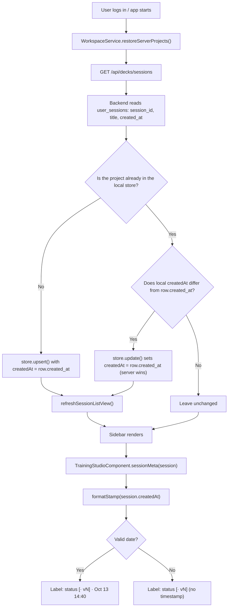
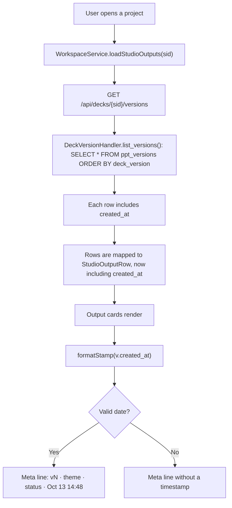
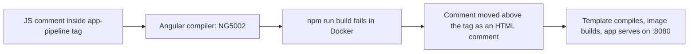

# Creation Timestamps in the Project List and Output Cards

This document describes a change to the SE Agent web app that shows *when* things were
created, plus a build fix that was needed to run the app in Docker. It lists why each change
was made, which files were touched, and how the data flows from the database to the screen.

## Summary

| # | Change | Where the user sees it |
|---|--------|------------------------|
| 1 | Show the project creation time in the Training Studio sidebar | `done · v1 · Oct 13 14:40` under each project name |
| 2 | Show the deck version creation time on each output card | `v1 · Internal · generated · Oct 13 14:48` |
| 3 | Make the server value the source of truth for the project creation time | Correct time even for projects first created in this browser |

## Why these changes were made

**No way to tell when something was created.** The sidebar showed only `status · version`
and the output cards only `version · theme · status`. Users could not tell when a project was
started or when a given deck version was generated.

**Stale creation time for locally cached projects.** The app keeps a local copy of the project
list. A project created in this browser kept the browser clock's time and was never replaced by
the server's value. The backend's `user_sessions.created_at` is the authoritative value, so the
display must use it.

## Data sources

| Shown on | Field used | Backend table / column | How it reaches the frontend |
|----------|-----------|------------------------|-----------------------------|
| Sidebar project row | `Session.createdAt` | `user_sessions.created_at` | `GET /api/decks/sessions` (the list of the user's projects) |
| Output card | `StudioOutputRow.created_at` | `ppt_versions.created_at` | `GET /api/decks/{session_id}/versions` |

Both columns are `TIMESTAMPTZ DEFAULT now()` and are returned as ISO-8601 strings in UTC
(for example `2026-10-13T09:10:57.914715+00:00`). **No backend change was needed**; both
endpoints already returned these fields.

The browser converts the value to the viewer's local timezone when formatting, so
`2026-10-13 09:10:57+00` shows as `Oct 13 14:40` for a user in IST (UTC+5:30).

## Flow: sidebar project timestamp

## Flow: output card timestamp

## Flow: build fix

## Files changed

| File | Change |
|------|--------|
| `src/app/main/main.component.html` | Moved the inline `/* ... */` comment out of the `<app-pipeline>` attribute list and turned it into an HTML `<!-- ... -->` comment above the tag. Fixes the `NG5002` build error. |
| `src/app/models/workspace.models.ts` | Added optional `created_at?: string \| null` to `StudioOutputRow`. |
| `src/app/shared/services/workspace.service.ts` | `restoreServerProjects()`: for projects already in the local store, replace `createdAt` with the server's `created_at` when they differ, and refresh the list view when anything was corrected or added. `loadStudioOutputs()`: pass `created_at` from each version row into `StudioOutputRow`. |
| `src/app/training-studio/training-studio.component.ts` | New `formatStamp()` helper (day, short month, 24-hour time; empty string for missing or invalid dates). `sessionMeta()` now appends the project creation time for every project. |
| `src/app/training-studio/training-studio.component.html` | Output card meta line shows the version timestamp. Sidebar `.meta` span gets a `title` tooltip with the full text. |
| `src/styles.scss` | `.session-item .meta` is `display: block; white-space: nowrap` so the label stays on one line. New `.output-stamp { white-space: nowrap }` keeps the date and time together on output cards. Uses existing variables only, so light and dark themes are unaffected. |

No backend files, dependencies, or Docker files were changed.

## Display rules

- Format: `Oct 13 14:40` (short month, day, 24-hour `HH:mm`, local timezone). No am/pm and no
  comma, so it fits on one line in the sidebar.
- The timestamp is shown for every project, including ones with no deck yet
  (for example `new · Oct 15 18:02`).
- It is hidden while a project is being deleted (`deleting…`) or when its status failed to load.
- If a date is missing or cannot be parsed, the timestamp is simply omitted; nothing else breaks.
- Seconds are not shown.

## Behaviour notes

- The sidebar time is the **project** creation time and does not change when new deck versions
  are generated. The per-version time lives on the output card.
- A project that exists only in the browser and has not yet been saved to the server shows the
  browser's creation time until the next login sync replaces it with the server value.
- Regenerating the same deck version does not change that version's `created_at`
  (the backend upsert in `record_version` does not touch it).

## How to test

1. Build and run: `docker compose -f docker-compose.local.yml up --build -d`, then open
   http://localhost:8080 and hard-refresh (Ctrl+Shift+R).
2. Check the sidebar: every project shows a time after its status (and version, if any).
3. Compare against the database. `user_sessions.created_at` for a project should match the
   sidebar time after converting UTC to your local timezone.
4. Open a project with a deck and check the output card. The time should match
   `ppt_versions.created_at` for that version.
5. Create a new project: it should show `new · <current time>` immediately.
6. Toggle light and dark themes and confirm the label stays on one line and remains readable.
7. Narrow the sidebar if possible and confirm the label does not wrap to a second line.
